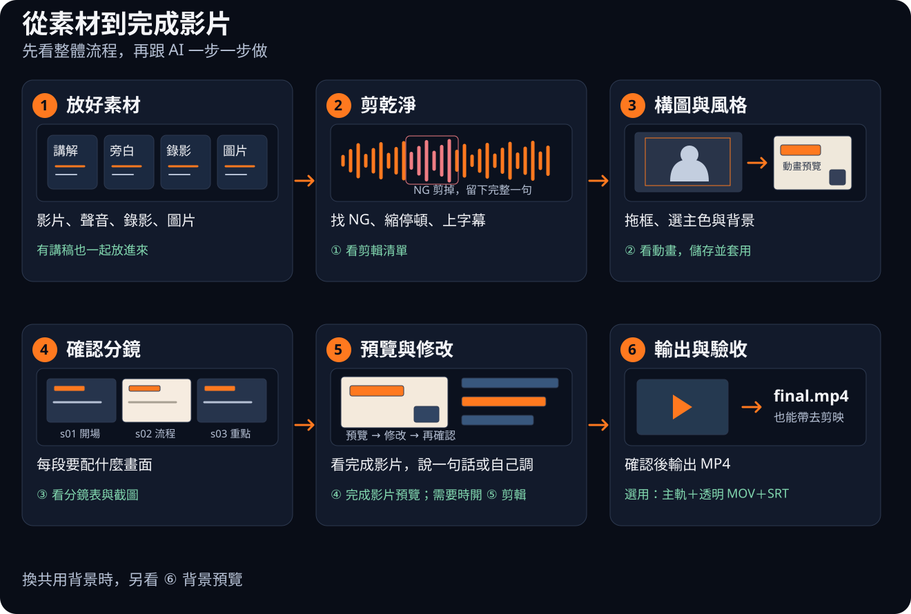
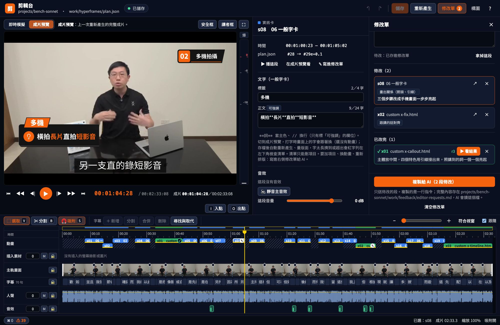
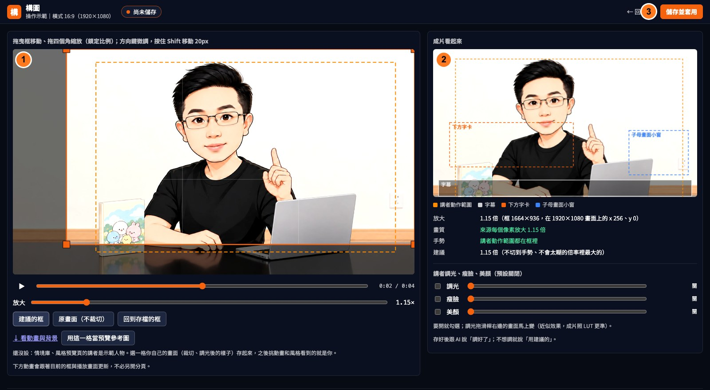
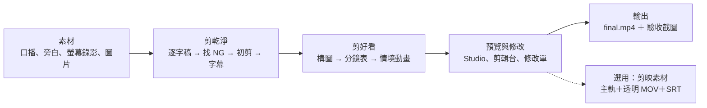

<h1 align="center">auto-edit-workspace</h1>

<p align="center"><b>AI 自動剪輯工作區：放好素材，用白話文剪成片</b></p>

<p align="center">
  <a href="LICENSE"></a>
  
  
  
  
</p>

<p align="center">
  <a href="https://deanlin.net/auto-edit-workspace/"></a>
</p>

<p align="center">
  <a href="https://deanlin.net/auto-edit-workspace/">官網</a> ·
  <a href="https://deanlin.net/auto-edit-workspace/shared/template/">情境庫</a> ·
  <a href="https://deanlin.net/auto-edit-workspace/shared/template/fx/">字卡動態</a> ·
  <a href="PROMPTS.md">提示詞</a> ·
  <a href="shared/template/EDITOR.md">剪輯與構圖</a> ·
  <a href="#常見問題">常見問題</a>
</p>

準備好影片、聲音、圖片這些素材，**用白話文跟 AI 說「剪乾淨」「做成片」**，它就幫你剪掉講錯的地方、上字幕、加資訊卡和動畫、配音效。每一步都會停下來給你看；不滿意的地方，說一句話、在剪輯台自己拖，或勾在修改單上交給 AI 重做。

Claude Code、ChatGPT（Codex）、MiniMax Code、Cursor 都能用。工作區開源免費，轉檔、轉字幕、render 都在你自己的電腦上做。

> **English** — An open-source AI video editing workspace for talking-head videos. Drop in your footage, voice-over, screen recordings and images, then tell your AI agent (Claude Code, Codex, MiniMax Code or Cursor) in plain language to "cut it clean" or "make the final cut": it removes flubbed takes, aligns subtitles to your script, adds info cards, scene animations and sound effects, and renders an MP4 (or CapCut-ready layers). A browser-based editor lets you trim, fix subtitles and card text, and queue redo requests for the agent. The framing page previews your footage in animations, with custom colors, uploaded backgrounds and AI-generated background options applied per project. Built on [HyperFrames](https://github.com/heygen-com/hyperframes); docs are in Traditional Chinese.

影片教學「AI 自動剪輯 EP1」：待補

## 目錄

| 想知道 | 看這幾節 |
|---|---|
| 怎麼開始 | [四步開始](#四步開始)・[支援的 AI Agent](#支援的-ai-agent) |
| 能做什麼 | [你說一句，AI 做一段](#你說一句ai-做一段)・[不滿意就改](#不滿意就改) |
| 背後怎麼運作 | [AI 判斷，程式計算](#ai-判斷程式計算) |
| 剪自己的影片 | [開自己的專案](#開自己的專案)・[錄影前檢查](#錄影前檢查)・[設定講者](#設定講者) |
| 先看畫面、換風格 | [構圖：用自己的畫面看動畫](#構圖用自己的畫面看動畫)・[換成自己的風格](#換成自己的風格) |
| 帶去剪映 | [搭配剪映](#搭配剪映選用) |
| 卡住了 | [常見問題](#常見問題)・[PROMPTS.md「卡住的時候」](PROMPTS.md) |
| 每個檔案在做什麼 | [CONTENTS.md](CONTENTS.md)（模板、工具、文件總覽） |

## 四步開始

<p align="center"><a href="dev/site/guides/workflow.svg"><picture><source media="(max-width: 600px)" srcset="dev/site/guides/workflow-mobile.svg"></picture></a></p>

先看這張流程圖：你準備素材，AI 剪片；做到剪輯清單、構圖、分鏡、預覽時，停下來讓你確認。點圖可放大。

1. **取得工作區**，三種方式挑一種：
   - 會用終端機：`git clone https://github.com/dean9703111/auto-edit-workspace.git`
   - 在 GitHub 頁面點「Code → Download ZIP」。解壓縮後的資料夾名稱會多一個 `-main`，不影響使用；Windows 要先「解壓縮全部」再打開。
   - 照影片的做法：打開 MiniMax Code 桌面版，先選 Local，再點 Select folder 選桌面，貼上 [PROMPTS.md](PROMPTS.md) 第 0 步的提示詞，AI 會幫你抓下來（沒裝 git 它會教你裝）。
2. **用你的 Agent 打開工作區**：選看得到 `AGENTS.md` 的那一層。桌面版選這個資料夾；終端機版先 `cd auto-edit-workspace` 再啟動（例如 `claude`、`codex`）。
3. **說「幫我檢測環境」**：AI 照 [setup/](setup/README.md) 的手冊檢查 git、Node.js、ffmpeg、whisper、auto-editor、HyperFrames 和 9 支 Skill，先列清單問你，同意後一步一步裝好。Mac 和 Windows 都有（Windows 還沒實測，歡迎回報）。
4. **剪範例**：說「剪乾淨 @projects/example」，接著「做成片」、「可以了，輸出成片」。完整提示詞照 [PROMPTS.md](PROMPTS.md) 的順序貼。

你只需要準備一個 AI Agent（見[支援的 AI Agent](#支援的-ai-agent)），照影片做的話裝 [MiniMax Code 桌面版](https://agent.minimax.io/download)。PROMPTS.md 的畫面說明以 MiniMax Code 為例，提示詞本身每個 Agent 都能貼。

## 你說一句，AI 做一段

| 你說 | AI 會做 |
|---|---|
| 「剪乾淨」 | 找出講錯重講、卡住的句子剪掉，縮短停頓，照講稿上字幕 |
| 「做成片」 | 看每段在講什麼，配上資訊卡、情境動畫、子母畫面和音效，人聲音量調到一致 |
| 「配螢幕錄影」 | 把操作畫面插到講到的那一段，放大、框出重點，多步驟的操作標上 STEP |
| 「可以了，輸出成片」 | 輸出 `final.mp4`，附上驗收截圖 |
| 「輸出剪映素材」 | 拆成主軌、透明背景的動畫片段和字幕檔，帶去剪映繼續剪 |

流程有六種停點：① 剪輯清單、② 構圖、③ 分鏡表、④ Studio 預覽；需要自己調整時開 ⑤ 剪輯台，換共用背景時看 ⑥ 背景預覽。AI 會告訴你這一步要看什麼、回什麼；例如構圖調好後按「儲存並套用」，再回「調好了」。

畫面會長什麼樣子，先到[官網的情境庫](https://deanlin.net/auto-edit-workspace/shared/template/)看（本機打開 `shared/template/index.html` 也可以，建議用 Chrome 或 Edge）：18 種情境模板、17 支情境動畫範例、示意動畫、40 種字卡動態。頁面上方可以切換風格包和亮色／暗色，還沒開始剪就能比較。

## 不滿意就改

AI 先做一版，你有三種改法：

| 改法 | 適合 | 怎麼做 |
|---|---|---|
| 說一句話 | 知道要改哪一段、怎麼改 | 「s05 往左移」「s09 字太多」「s12 重新設計」 |
| 剪輯台自己調 | 字幕、音量、裁剪、轉場、卡片上的字 | 說「打開剪輯台」，AI 給你網址 |
| 修改單交給 AI | 想讓 AI 重做好幾段，但說不太清楚怎麼改 | 在剪輯台點一段，勾「更有質感」「以圖像展示為主」，複製一行指令貼給 AI |

### 一句話就能改的地方

| 想調整 | 怎麼說（例） | 說明 |
|---|---|---|
| 哪些地方要剪 | 「第 3 列不要剪」 | 剪輯清單逐條列出要剪的句子和原因，你確認後才剪 |
| 畫面放大 | 「用建議的」或在構圖台拖框 | 構圖台在影片上直接拖框，最多放大 2 倍；AI 先算好一個不切到手勢的建議框 |
| 某一段的卡片 | 「s05 往左移」「s09 字太多」 | 只改那一段，改前改後都存版本 |
| 某一段的動畫 | 「s12 重新設計」「s12 用 v1」 | 先出新的動畫分鏡給你確認；不喜歡可以退回舊版，也有左右對照影片 |
| 音效、配樂 | 「s08 不要音效」「結尾加配樂」 | 音效只從內建的音效庫挑；超過一分鐘沒有音效時 AI 會補上；要不要片尾配樂，分鏡表會問你 |
| 講者畫面 | 「這集要調光、瘦臉」「這集要美顏」 | 預設關閉，每次停下來的回報都會寫現在開了沒；見[講者調光、瘦臉、美顏](#講者調光瘦臉美顏選用) |
| 主色、背景、亮暗 | 「這集換暗色」「換成藍圖風格」 | 見[換成自己的風格](#換成自己的風格) |
| 橫式／直式 | 「做成直式短影片」 | 直拍素材可做 Shorts、Reels、抖音，字幕和版面用直式規格；目前不支援橫拍轉直式 |

### 剪輯：字幕、音量、卡片自己調

<p align="center"></p>

說「打開剪輯台」，AI 會給你一個本機網址，在瀏覽器裡自己調，存檔後寫回這一集的設定。現在介面名稱是「剪輯」與「構圖」，原本的提示詞照樣能用：

- **時間軸**：主軌、字幕、動畫、插入素材、人聲波形、音效各一軌。拖邊緣裁剪、切掉一段、調每一軌的音量、加淡入淡出和轉場。
- **字幕**：改錯字、拆句、合併、拖時間；你改過的字幕 AI 不會再改回去。
- **卡片上的字**：點一張資訊卡就能改字，切到「成片預覽」打字時畫面上的字跟著換；存檔後自動重新產生、量版面，字擠到或超出會列在檢查清單。
- **構圖、講者**：上方「構圖」另開一頁，拖框、調光、選主色和背景，用自己的畫面預覽動畫；講者的瘦臉、美顏也能開關、調強度。

細節在 [EDITOR.md](shared/template/EDITOR.md)。

### 構圖：用自己的畫面看動畫

說「做成片」到停點 ②，或在「剪輯」上方按「構圖」，就能在同一頁調整畫面與這一集的風格：

<p align="center"><a href="dev/site/guides/framing.jpg"></a></p>

**看圖操作：① 左邊拖框 → ② 右邊看版面 → ③ 儲存並套用。** 介面截圖使用內建示範講者，點圖可放大。

1. **拖框、調講者**：決定放大多少、講者放哪裡；旁邊看套上字幕與字卡的位置，也能開調光、瘦臉、美顏。
2. **選主色、換背景**：選色或輸入色碼。全畫面、側邊欄、章節各有一張背景，可以拖入或點選上傳 JPG、PNG、WebP，每張 12 MB 以內。
3. **用自己的畫面看動畫**：目前播放頭的畫面連同裁切、調光，直接放進下方的動畫預覽。先看六個範例，也能篩選情境動畫、版型、字卡，展開全部或點開大預覽。滑鼠移入循環播放，移開回到內容出齊的畫面；還沒儲存也能比較。
4. **滿意後按「儲存並套用」**：確認構圖、主色和背景。已有成片時，工具會自動更新底片與剪輯預覽；還沒有成片就先存設定，接著做分鏡與動畫。

<p align="center"><a href="dev/site/guides/design.jpg"></a></p>

**往下看：① 左邊換色、換圖 → ② 右邊比較動畫。** 滑鼠移入會播放，點開可放大；這一步先看效果，最後回頁首按「儲存並套用」。

想請 AI 畫背景：選主色、放參考圖（選用）、選設計風格並補描述，按「複製生圖指令」貼給 AI。AI 依指令產生 **A／B／C 三組、每組三種用途，共 9 張背景**。回構圖頁選「全畫面／側邊欄／章節」，各自挑原本背景或 A／B／C，也能混搭；新圖會在切回頁面時載入，或按「載入圖片」。最後一樣按「儲存並套用」。

<p align="center"><a href="dev/site/guides/background-flow.svg"><picture><source media="(max-width: 600px)" srcset="dev/site/guides/background-flow-mobile.svg"></picture></a></p>

這些設定只套用這一集，原素材、共用模板和歷次草稿都會保留。頁面的按鈕會準備生圖指令，圖片由你使用的 AI 工具產生。

### 修改單：勾給 AI 重做

想讓 AI 把某幾段做得更好，但說不清楚要怎麼改，就用剪輯台的修改單：

1. 按上方「修改單」，最右邊多一欄。在時間軸點一段動畫或螢幕錄影，修改單列出它的字幕。
2. 點想怎麼改（「流程更細節」「以圖像展示為主」「畫出關係（箭頭、引線）」「跟講的話對齊」「更有質感」…），或自己寫一句。點了就存，不用按儲存。
3. 換下一段，一直累積。時間軸上那段會標 ✎。
4. 按「複製給 AI」，把那一行指令貼給 AI。AI 每段派一個子代理一起改，改好停在 Studio 預覽。
5. 改完的段移到「已改完」、標 ✓，列出 AI 做了什麼；按「▶ 看結果」跳到那段。下次複製只送還沒改的。

## AI 判斷，程式計算

剪口播影片最花時間的，是一直重複的手工：找出講錯重講的地方、對字幕、做字卡、讓動畫跟著講到的詞出現、配音效、調音量。這個工作區把這些事拆成兩半：

- **AI Agent 負責判斷**：哪一句是 NG、這段口播在講什麼情境、該用哪個版面和動畫、卡片上寫什麼。
- **程式負責計算**：逐字稿的詞級時間、NG 的起訖、字幕斷句與對時、剪接點、動畫每一拍的秒數、版面有沒有撐破或擋到臉、人聲與音效的響度。

AI 不自己算秒數，也不從零寫動畫。它讀逐字稿、填好一份 `plan.json`，寫上「這張卡在講到『兩支』時出現」（`#38@兩支`），程式就把字幕、資訊卡、情境動畫、子母畫面、音效組成一支 [HyperFrames](https://github.com/heygen-com/hyperframes)（HTML 轉影片）專案，再輸出成 `final.mp4`。守則寫在每個 Agent 都會讀的 `AGENTS.md`，流程寫成 9 支 Skill，同樣的素材、同樣的分鏡，換哪個 Agent 來做結果都一樣。



| 階段 | AI Agent 判斷 | 程式計算 | 停下來給你看 |
|---|---|---|---|
| 剪乾淨 | 看重講候選和講稿外的話，決定哪些列進剪輯清單 | 主軌轉檔、whisper 詞級逐字稿、對講稿找重講並列出章節起點（`media.mjs ng-scan`）、NG 對齊停頓並產生 auto-editor 指令（`ng-snap`）、初剪驗證（`verify-rough`）、字幕照講稿斷句對時（`srt-align`） | ① 剪輯清單 |
| 構圖 | 拖框決定講者位置，調光、選主色與背景，用自己的畫面看動畫後儲存並套用 | 量講者動作範圍、算建議的框（`qc.mjs framing`）、臉部偵測與瘦臉美顏底片（`look.mjs`）、保存並套用本集風格 | ② 構圖 |
| 分鏡 | 每段先問四題（有沒有對得上的錄影、有沒有看得見的東西在動、是不是抽象的結構、是不是只有一句重點），決定用錄影、示意動畫、情境動畫還是字卡，再寫卡片上的字 | 檢查字數上限、版面、文字出現時間對不對得上講到的詞（`build.mjs --check`），截出每段的完成態（`qc.mjs storyboard`） | ③ 分鏡表 |
| 定稿 | 照你的意見、修改單改指定的段落 | 組成 HyperFrames 專案、音效對準畫面事件、人聲調到 −14 LUFS（`build.mjs`）；量文字撐破、被裁、擋臉（`audit.mjs`）；每段留版本（`versions.mjs`） | ④ Studio 預覽、⑤ 剪輯台 |
| 輸出 | 看觀影總表判斷哪裡怪 | render、檢查格式、長度、響度、黑畫面、畫面凍結（`qc.mjs final`）；選用：拆成剪映素材（`capcut.mjs`） | — |

每個停點要回什麼、做完寫回哪裡，在 [AGENTS.md](AGENTS.md)「停點總表」。每支工具做什麼，見 [CONTENTS.md](CONTENTS.md)。

## 支援的 AI Agent

要用能在你電腦上執行指令、讀寫檔案的 Agent（ChatGPT 網頁版不行，要用 Codex）。打開工作區時選看得到 `AGENTS.md` 的那一層，Agent 就會讀到守則。

| Agent | 守則 | 9 支 Skill |
|---|---|---|
| Claude Code | 自動讀 `AGENTS.md` | 環境檢測時由 `node setup/install-skills.mjs` 裝進工作區的 `.claude/skills/` |
| MiniMax Code | 自動讀 `AGENTS.md` | 環境檢測時裝進 `~/.minimax/skills/` |
| ChatGPT（Codex） | 自動讀 `AGENTS.md` | `AGENTS.md` 會要它直接讀 `.agents/skills/<名稱>/SKILL.md`，不用安裝 |
| Cursor | 自動讀 `AGENTS.md` | 同上 |
| 其他 Agent | 開工先說「先讀 AGENTS.md」 | 同上 |

影片裡示範的是 MiniMax Code（模型 MiniMax-M3.1-Flash）。守則和 Skill 都寫成一步一步照做的格式，不需要最強的模型；換成其他 Agent 遇到問題，歡迎回報。

## 開自己的專案

一支影片＝`projects/` 底下的一個資料夾，不用再複製整個工作區。跟 AI 說「開一個新專案 EP2」，它會幫你建好；也可以自己建，結構是：

```
projects/EP2/
├─ 講稿.md            這一集的講稿（選用）
├─ assets/            素材（你放進來的檔案）
│  ├─ camera/         真人錄影：有畫面的口播影片
│  ├─ voice/          聲音：只有聲音的旁白
│  ├─ screen/         螢幕錄影：操作畫面（邊錄邊講的也放這裡）
│  └─ images/         圖片：截圖、照片
├─ work/              AI 的中間產物（自動產生）
└─ output/            成片：final.mp4、驗收截圖、剪映素材（自動產生）
```

四種素材各放什麼：

- **`camera/` 真人錄影**：有畫面有聲音的口播，是主軌。
- **`voice/` 聲音**：只有聲音的旁白，也是主軌。這種地方沒有畫面，AI 會配上螢幕錄影或圖片；找不到對得上的素材，就做全畫面的示意動畫；這種段沒有講者小窗，卡片自動放寬到整個畫面（情境庫「全寬」）。旁白有一段重錄的，補錄檔也放這裡，跟 AI 說哪一段取代哪一段（例「录音3 取代旁白 9:37–10:03」），它會只取那一段接進主軌。
- **`screen/` 螢幕錄影**：操作畫面，預設靜音插入，四周是黑底。口播講到畫面上的按鈕、欄位、選項時，AI 會加紅框、說明卡或放大鏡，一步一步的操作加 STEP 膠囊；只對好時間、一個標註都沒加的錄影段，檢查會提醒。如果是邊錄邊講（錄影裡就有你的講解），AI 會自動認出來接進主軌：只剪講錯重講的地方、停頓保留，畫面照原本的錄影對上。
- **`images/` 圖片**：截圖、照片，插入影片中。

講稿存成 `講稿.md`；沒有講稿也可以，AI 只會轉繁體、補標點。場地照不用準備，AI 會從你的影片自動截。提示詞要指定專案，例如 `@projects/EP2`，AI 一次只處理一個專案。

舊版的中文資料夾（`素材/`、`成片/`…）要改成英文名稱才能接著用，對照表在 [CONTENTS.md「舊專案的資料夾改名」](CONTENTS.md#舊專案的資料夾改名)。

### 素材放在外接硬碟

素材太大放不進電腦時，專案資料夾可以放在外接硬碟，在 `projects/` 底下建一個捷徑指過去就好（Mac：`ln -s /Volumes/<硬碟>/EP2 projects/EP2`；Windows：`mklink /J projects\EP2 E:\EP2`）。工具照常讀寫外接硬碟上的 `assets/`、`work/`、`output/`；產生成片時會在 `work/hyperframes/` 放一個小捷徑，確保用的是工作區指定的 HyperFrames 版本。exFAT 格式的硬碟會多出 `._` 開頭的檔案，工具會略過，不用刪。

### 錄影前檢查

AI 剪得再好，也救不回糊掉的畫面和聽不清楚的聲音。開錄前花一分鐘看這幾項：

- **收音**：麥克風離嘴 15–30 公分，有領夾式麥克風更好。關掉冷氣、風扇，先錄 10 秒聽一次，確認沒有雜音、沒有爆音。
- **畫面**：手機或相機鎖定曝光、對焦和白平衡，不要背對窗戶。整集機位不要動，講者框只要量一次。
- **講錯時**：停 1 秒，從那一句的開頭重講，不要接著往下講。AI 是靠逐字稿裡重複的句子找 NG，auto-editor 是靠停頓剪，停一下兩邊都好剪。
- **頭尾**：開頭、結尾各留 2 秒不講話，淡入淡出才不會切到字。
- **手勢**：盡量在身體前方比畫，不要往畫面左下伸，那裡是資訊卡的位置。
- **螢幕錄影**：解析度 1920×1080 以上，滑鼠移動放慢，每個操作前先停 1 秒，AI 配對畫面和加運鏡會比較準。
- **講稿**：用 `## 章名` 分章、`### 小節名` 分小節（例 `### STEP 1｜設定資料夾`），成片右上角會一直顯示目前在講哪一章哪一節；多步驟的螢幕錄影，檔名也寫上 STEP 步驟，AI 會照它標 STEP。

### 設定講者

講者介紹卡（14）會顯示你的名字和頭銜，金句卡（15）會署你的名字。這些是你個人的資料，放在 `shared/講者.json`：每個人本機各一份，**不會進 git**，之後更新工作區也不會被蓋掉。第一次使用時跟 AI 說：

```
講者設定成林大寶，頭銜影音創作者、科技部落客、線上課程講師
```

或自己跑 `node shared/template/tools/brand.mjs speaker --name "林大寶" --titles "影音創作者,科技部落客,線上課程講師"`（姓名最多 5 字；頭銜 1–3 個，每個最多 6 字）。不想要講者介紹卡就說「不要講者介紹」（`brand.mjs speaker off`）。

還沒設定時，講者介紹卡會顯示示範人物「林大寶」，AI 接手專案和檢查 plan.json 時都會提醒你。請來賓的那一集，AI 會在那一段另外寫來賓的名字，不影響你的設定。

## 換成自己的風格

**只想調這一集**，先在[構圖頁](#構圖用自己的畫面看動畫)選主色、上傳背景，或複製指令請 AI 生圖，選好再按「儲存並套用」。同頁就能看動畫效果。

**想讓之後每一集共用一套**，可以把主色、子母畫面外框、背景圖做成風格包。內建「預設」（橘色）和示範用的「藍圖」（藍色），亮色、暗色都有，不用改程式：

| 想做的事 | 跟 AI 說 | 會發生什麼 |
|---|---|---|
| 看有哪些風格 | 「有哪些風格」 | 列出 `shared/template/styles/` 的每一包；也可以直接在情境庫上方切換預覽 |
| 只有這一集換 | 「這集用藍圖風格」 | 在這一集的 `plan.json` 寫 `"style": "藍圖"`，其他集不受影響 |
| 整個工作區換 | 「整個換成藍圖」／「換回預設」 | `brand.mjs use 藍圖`，之後每一集預設都用它 |
| 做自己的一包 | 「幫我做一個風格包：主色深綠、背景要簡潔」 | 換色、產生亮暗背景，給你看預覽，你同意才存成 `styles/<名稱>/` |
| 暗色主題 | 「這集換暗色」 | 這一集的 `plan.json` 寫 `"theme": "dark"`，用那一包的暗色背景 |
| 換主色 | 「把主色換成深綠」 | `brand.mjs "#RRGGBB"` 換色、算好字的對比，重畫子母畫面外框 |
| 換背景圖 | 「換背景」 | 你給圖就縮放裁切成全畫面、側邊欄、章節轉場三種尺寸；沒給圖就照這台電腦能用的工具產生。先給你看並排預覽和留空區，同意才換 |

自己動手的話：`node shared/template/tools/brand.mjs list`、`use <名稱>`、`pack <名稱> --color "#RRGGBB" --bg <資料夾>`。換整個工作區前，如果目前的設定不屬於任何一包，工具會先停下來請你存起來，不會弄丟。細節在 `shared/template/USAGE-reference.md` R9。

### 講者調光、瘦臉、美顏（選用）

預設都關閉，講者畫面維持原樣。停點 ② 的構圖台下面就能開：勾調光、瘦臉、美顏，拖強度（建議調光 0.8、瘦臉 0.6，對照剪映「智能調色」80、「瘦臉」60；美顏 0.5＝磨皮、膚色提亮、淡化黑眼圈，眼睛、眉毛、嘴巴不動），畫面馬上變；瘦臉、美顏要先按「偵測臉部」在背景跑，跑完出現前後對照。臉部偵測在本機做、不上傳。

同一頁按「用這一格當預覽參考圖」，情境庫和風格預覽頁裡的講者就換成你自己的畫面（只存在你的電腦，不進版控）。之後想改，跟 AI 說「這集要調光、瘦臉」，或在剪輯台調；想以後每一集都開，說「以後都要調光」。

## 搭配剪映（選用）

習慣在剪映（CapCut）做最後調整的話，跟 AI 說「輸出剪映素材」，它會跑 `node shared/template/tools/capcut.mjs`，在 `output/capcut/` 產生：

| 檔案 | 內容 | 在剪映怎麼用 |
|---|---|---|
| `主軌.mp4` | 講者畫面＋人聲＋片尾配樂（調光、瘦臉、剪輯台的跳接都在裡面），沒有字卡和字幕 | 拖到主軌道，從 0 秒開始 |
| `01_s01_0m00.00s.mov`… | 每段字卡、情境動畫一支，ProRes 4444、有透明通道，帶那段的音效 | 拖到畫中畫軌道，起點對齊檔名裡的時間 |
| `字幕.srt` | 畫面上實際顯示的字幕 | 文本 → 本地字幕 → 匯入，再套你的字幕樣式 |
| `清單.md` | 每一支放在第幾秒、多長、什麼版面 | 照表排 |

疊加卡的 MOV 只有卡片（其他地方透明）；子母畫面、全幕、半畫面的段整格都有畫面（講者小窗在裡面）。章節角標不會輸出，在剪映用文字補。每段約 30 秒 render，5 秒的段約 30 MB。

## 常見問題

更完整的清單在 [PROMPTS.md](PROMPTS.md) 最後的「卡住的時候」。

### 逐字稿變成英文

轉逐字稿的指令要帶 `--model small --language zh`。預設的 `small.en` 會把中文翻成英文。

### auto-editor 回報參數錯誤

Skill 文件寫的參數名稱，可能和你裝的版本不同。以 `auto-editor --help` 為準。

### Mac M 系列晶片上，轉逐字稿的 whisper 當掉

在整行指令的最前面加上 `GGML_METAL_BF16_DISABLE=1`，再執行一次。

### 我已經全域裝了 hyperframes，還要 `npm install` 嗎

要。工作區的 `package.json` 把 HyperFrames 固定在一個版本，模板、字幕位置、render 參數都是照這一版測過的；`npx hyperframes` 和工作區的工具（audit、剪輯台的成片預覽、剪映素材、分段預覽）都只用工作區 `node_modules/` 裡的這一版。沒有 `npm install` 時，工作區的工具會直接停下來提示你；版本不同時 `build.mjs` 會印 ⚠ 提醒。

### 修改單送出後，怎麼知道 AI 改好了

AI 改完會寫一份回饋紀錄（`work/feedback/r<N>.md`），剪輯台讀到就把那段移到「已改完」、標 ✓，列出 AI 做了什麼。按「▶ 看結果」切到成片預覽、跳到那段。重新整理剪輯台的頁面就會更新。

### 構圖頁選了背景，為什麼成片還沒變

選色、換圖時先更新同頁動畫預覽。確認後按頁首的「儲存並套用」，才會套用到這一集；已有成片會自動更新剪輯預覽，沒有成片則留給後續製作使用。AI 生圖完成後，切回頁面或按「載入圖片」，選好圖再儲存。

### 更新工具後，構圖動畫載不出來

請 AI 重新開啟剪輯：`node shared/template/tools/editor.mjs --project projects/<專案>`。工具會檢查後端版本，需要時以原本的 port 重啟。回構圖頁按「重新連接」可保留拖好的框；舊頁面沒有這個按鈕時，重新整理頁面。

### Windows 可以用嗎

可以，`setup/windows.md` 有 Windows 的安裝路線。不過作者只在 Mac 上實測過，Windows 遇到問題歡迎回報。

### `hyperframes doctor` 顯示 Some checks failed

TTS、BGM、Docker 都是選用功能，這個工作區用不到。只有這幾項失敗的話，可以略過。

### 一支影片跑很久，不知道時間花在哪

跟 AI 說「時間花在哪」，它會跑 `node shared/template/tools/status.mjs --project projects/<專案> --timeline`：照每個產物第一次出現的時間和停點紀錄，列出總時長、等你回覆的時間、AI 在做事的時間，以及最久的三段。舊專案也能看。想快一點：提示詞加「快速初稿」（動畫之後再一次平行做），或「做到 Studio」（中間不停）。

## 回報問題與貢獻

- 遇到問題：到 [Issues](https://github.com/dean9703111/auto-edit-workspace/issues) 回報，附上用的 Agent、作業系統，以及工具印出的 ✖ 那一行原文。
- 想加新的情境模板、字卡動態或風格包：先開 Issue 討論，再送 Pull Request。模板的寫法在 `shared/template/USAGE-reference.md` R14，送之前跑一次 `node --test dev/tests/*.test.mjs`。
- 換成 Claude Code、Codex、MiniMax Code、Cursor 以外的 Agent 也能用的話，歡迎分享經驗。

## 授權

程式碼採 MIT，情境模板、情境動畫範例與字卡動態採 CC BY 4.0，第三方素材與示範影片的條件見 [NOTICE.md](NOTICE.md)。

9 個音效是 AI 生成或取自 Kenney（https://kenney.nl）的 CC0 素材，可以放進自己的影片、商用，不用標示出處。片尾配樂〈Cylinder Five〉（Chris Zabriskie）是 CC BY 4.0，預設不配；用到時影片說明欄要標示出處，build 會印出要貼的那一行。逐檔來源見 [shared/sfx/README.md](shared/sfx/README.md)。

## 作者

林鼎淵 (Dean Lin)，YouTube 頻道「工程師下班有約」。

- 影片：待補
- FB：https://www.facebook.com/deanlinbao
- Medium：https://dean-lin.medium.com/
- 書籍：[《工程師下班有約》](https://www.books.com.tw/products/0010935713)
