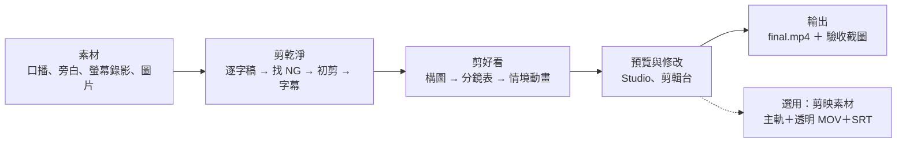

<h1 align="center">auto-edit-workspace</h1>

<p align="center"><b>AI 自動剪輯工作區：放好素材，用白話文剪成片</b></p>

<p align="center">
  <a href="LICENSE"></a>
  
  
  
  
</p>

<p align="center">
  <a href="https://deanlin.net/auto-edit-workspace/"></a>
</p>

<p align="center">
  <a href="https://deanlin.net/auto-edit-workspace/">官網</a> ·
  <a href="https://deanlin.net/auto-edit-workspace/shared/template/">情境庫</a> ·
  <a href="https://deanlin.net/auto-edit-workspace/shared/template/fx/">字卡動態</a> ·
  <a href="PROMPTS.md">提示詞</a> ·
  <a href="#常見問題">常見問題</a>
</p>

準備好影片、聲音、圖片這些素材，**用白話文跟 AI 說「剪乾淨」「做成片」**，它就幫你剪掉講錯的地方、上字幕、加資訊卡和動畫、配音效。每一步都會停下來給你看，不滿意的地方再用一句話微調。

Claude Code、ChatGPT（Codex）、MiniMax Code、Cursor 都能用：守則寫在每個 Agent 都會讀的 `AGENTS.md`，流程寫成 9 支 Skill，真正的剪輯計算交給工作區裡的程式。換哪一個 Agent，剪出來的規格都一樣。工作區開源免費，影片的轉檔、轉字幕、render 都在你自己的電腦上做。

> **English** — An open-source AI video editing workspace for talking-head videos. Drop in your footage, voice-over, screen recordings and images, then tell your AI agent (Claude Code, Codex, MiniMax Code or Cursor) in plain language to "cut it clean" or "make the final cut": it removes flubbed takes, aligns subtitles to your script, adds info cards, scene animations and sound effects, and renders an MP4 (or CapCut-ready layers). Built on [HyperFrames](https://github.com/heygen-com/hyperframes); docs are in Traditional Chinese.

影片教學「AI 自動剪輯 EP1」：待補

## 目錄

| 想知道 | 看這幾節 |
|---|---|
| 能做什麼 | [用說的就能剪片](#用說的就能剪片)・[哪些細節可以微調](#哪些細節可以微調) |
| 背後怎麼運作 | [這是什麼](#這是什麼)・[怎麼運作](#怎麼運作)・[支援的 AI Agent](#支援的-ai-agent)・[裡面有什麼](#裡面有什麼) |
| 第一次使用 | [事前準備](#事前準備)・[怎麼開始](#怎麼開始)・[設定講者](#設定講者)・[預覽情境庫](#預覽情境庫) |
| 剪自己的影片 | [開自己的專案](#開自己的專案)・[舊專案的資料夾改名](#舊專案的資料夾改名)・[錄影前檢查](#錄影前檢查) |
| 換成自己的風格 | [風格包](#換成自己的風格)・[換主色](#換主色)・[換背景圖](#換背景圖)・[講者調光、瘦臉](#講者調光瘦臉選用) |
| 到剪映繼續剪 | [搭配剪映](#搭配剪映選用) |
| 卡住了 | [常見問題](#常見問題)・[PROMPTS.md「卡住的時候」](PROMPTS.md) |
| 其他 | [回報問題與貢獻](#回報問題與貢獻)・[授權](#授權)・[作者](#作者) |

## 用說的就能剪片

不用學剪輯軟體，也不用寫程式。三個步驟：

1. **放素材**：口播影片放 `assets/camera/`，只有聲音的旁白放 `assets/voice/`，螢幕錄影、截圖、照片各有資料夾。有講稿的話，字幕會更準。
2. **說一句話**：用平常說話的方式告訴 AI 要做什麼。
3. **看預覽、再用一句話改**：AI 做到重要的地方會停下來給你看，你說「可以」它才往下。

| 你說 | AI 會做 |
|---|---|
| 「剪乾淨」 | 找出講錯重講、卡住的句子剪掉，縮短停頓，照講稿上字幕 |
| 「做成片」 | 看每段在講什麼，配上資訊卡、情境動畫、子母畫面和音效，人聲音量調到一致 |
| 「配螢幕錄影」 | 把操作畫面插到講到的那一段，放大、框出重點 |
| 「可以了，輸出成片」 | 輸出 `final.mp4`，附上驗收截圖 |
| 「輸出剪映素材」 | 拆成主軌、透明背景的動畫片段和字幕檔，帶去剪映繼續剪 |

情境動畫長什麼樣子，先到[官網的情境庫](https://deanlin.net/auto-edit-workspace/shared/template/)看。

## 哪些細節可以微調

AI 先做一版，你決定要不要改。大部分只要說一句話；字幕和音量也可以打開「剪輯台」自己拖。

| 想調整 | 怎麼說（例） | 說明 |
|---|---|---|
| 哪些地方要剪 | 「第 3 列不要剪」 | 剪輯清單逐條列出要剪的句子和原因，你確認後才剪 |
| 字幕 | 「打開剪輯台」 | 改錯字、拆句、合併、拖時間；你改過的字幕 AI 不會再改回去 |
| 畫面放大 | 「用 1.15 倍」 | 構圖有 1.0／1.15／1.3 三種倍率，先給你看預覽圖 |
| 某一段的卡片 | 「s05 往左移」「s09 字太多」 | 只改那一段，改前改後都存版本 |
| 某一段的動畫 | 「s12 重新設計」「s12 用 v1」 | 先出新的動畫分鏡給你確認；不喜歡可以退回舊版，也有左右對照影片 |
| 音效、配樂 | 「s08 不要音效」「結尾加配樂」 | 音效只從內建的音效庫挑，也能在剪輯台調音量 |
| 講者畫面 | 「這集要調光、瘦臉」 | 預設關閉；剪輯台有開關和強度滑桿 |
| 主色、背景、亮暗 | 「這集換暗色」「換成藍圖風格」 | 見[換成自己的風格](#換成自己的風格) |
| 講者名字 | 「講者設定成林大寶，頭銜…」 | 見[設定講者](#設定講者)，設定一次就好 |
| 橫式／直式 | 「做成直式短影片」 | 長片用橫式；Shorts、Reels、抖音用直式，字幕和版面自動換 |

## 這是什麼

剪口播影片最花時間的，是一直重複的手工：找出講錯重講的地方、對字幕、做字卡、讓動畫跟著講到的詞出現、配音效、調音量。這個工作區把這些事拆成兩半：

- **AI Agent 負責判斷**：哪一句是 NG、這段口播在講什麼情境、該用哪個版面和動畫、卡片上寫什麼。
- **程式負責計算**：逐字稿的詞級時間、NG 的起訖、字幕斷句與對時、剪接點、動畫每一拍的秒數、版面有沒有撐破或擋到臉、人聲與音效的響度。

AI 不自己算秒數，也不從零寫動畫。它讀逐字稿、填好一份 `plan.json`，寫上「這張卡在講到『兩支』時出現」（`#38@兩支`），程式就把字幕、資訊卡、情境動畫、子母畫面、音效組成一支 [HyperFrames](https://github.com/heygen-com/hyperframes)（HTML 轉影片）專案，再輸出成 `final.mp4`。同樣的素材、同樣的分鏡，不管哪個 Agent 來做，結果都一樣。

整個流程有六個停點，AI 做到那裡會停下來，把剪輯清單、構圖、分鏡表、預覽網址交給你決定，不會一路自己做到底。

## 怎麼運作



| 階段 | AI Agent 判斷 | 程式計算 | 停下來給你看 |
|---|---|---|---|
| 剪乾淨 | 逐字稿裡哪一句重講、卡住，列成剪輯清單 | 主軌轉檔（`media.mjs main`）、whisper 詞級逐字稿、NG 對齊停頓並產生 auto-editor 指令（`media.mjs ng-snap`）、初剪驗證（`media.mjs verify-rough`）、字幕照講稿斷句對時（`media.mjs srt-align`） | ① 剪輯清單 |
| 構圖 | 選畫面放大倍率 | 講者調光、瘦臉、臉部偵測（`look.mjs`），算出每個倍率的構圖預覽（`qc.mjs framing`） | ② 構圖倍率 |
| 分鏡 | 每段口播在講什麼情境、用哪個版面和動畫、卡片寫什麼 | 檢查字數上限、版面、文字出現時間對不對得上講到的詞（`build.mjs --check`），截出每段的完成態（`qc.mjs storyboard`） | ③ 分鏡表 |
| 定稿 | 照你的意見改哪一段 | 組成 HyperFrames 專案：字幕、資訊卡、子母畫面、音效對準畫面事件、人聲調到 −14 LUFS（`build.mjs`）；量文字撐破、被裁、擋臉（`audit.mjs`） | ④ Studio 預覽、⑤ 剪輯台 |
| 輸出 | 看觀影總表判斷哪裡怪 | render、檢查格式、長度、響度、黑畫面、畫面凍結（`qc.mjs final`）；選用：拆成剪映素材（`capcut.mjs`） | — |

第 ⑥ 個停點是換背景圖時的預覽。每個停點要回什麼、做完寫回哪裡，在 [AGENTS.md](AGENTS.md)「停點總表」。

## 支援的 AI Agent

要用能在你電腦上執行指令、讀寫檔案的 Agent（ChatGPT 網頁版不行，要用 Codex）。打開工作區時選看得到 `AGENTS.md` 的那一層，Agent 就會讀到守則。

| Agent | 守則 | 9 支 Skill |
|---|---|---|
| Claude Code | 自動讀 `AGENTS.md` | 環境檢測時由 `node setup/install-skills.mjs` 裝進工作區的 `.claude/skills/` |
| MiniMax Code | 自動讀 `AGENTS.md` | 環境檢測時裝進 `~/.minimax/skills/` |
| ChatGPT（Codex） | 自動讀 `AGENTS.md` | `AGENTS.md` 會要它直接讀 `.agents/skills/<名稱>/SKILL.md`，不用安裝 |
| Cursor | 自動讀 `AGENTS.md` | 同上 |
| 其他 Agent | 開工先說「先讀 AGENTS.md」 | 同上 |

影片裡示範的是 MiniMax Code（模型 MiniMax-M3.1-Flash）。守則和 Skill 都寫成一步一步照做的格式，不需要最強的模型；換成其他 Agent 遇到問題，歡迎回報。

## 裡面有什麼

字型、模板、圖示、預覽頁、音效、示範素材都已經放好，不用另外下載。

| 項目 | 數量 | 位置 | 怎麼用 |
|---|---|---|---|
| 情境模板 | 18 個 | `shared/template/scenes/` | 版面 9 個（章節轉場、章節角標、半版側邊欄、全畫面 4 種、兩側、講者介紹），下方字卡 7 個（一般、重點、步驟、問答、小技巧、總結、金句），條列 2 個。AI 只要填文字、圖示和要對齊的字幕句；圖示會自動「描出來」 |
| 情境動畫範例 | 17 支（流程、比喻、前後對比、數值變化、警告、提示詞、介面示意、架構、分支、分層、清單打勾、時間軸、雙邊比較、主體標註、趨勢、比例環、痛點與解法） | `shared/template/custom/` | 口播在講一個情境時，AI 從這裡挑一支改成這一集的動畫，不用從零寫；動畫用 `P.at('#N@詞')` 綁到講到的那個詞，不用手算秒數。做法在 `shared/template/USAGE-reference.md` R7 |
| 字卡動態 | 40 種 | `shared/template/fx/` | 打開 `shared/template/fx/index.html` 看效果，分鏡寫編號就能用 |
| 動畫原始檔 | 18 情境＋40 字卡動態都是 HTML（HyperFrames） | `shared/template/scenes/<編號-key>/template.html`＋`scene.json`、`shared/template/fx/effects/fx-NN-*.html` | AI 直接讀、改、換；`fx/renders/` 和 `gallery/` 只是預覽用的影片和圖。要改模板先看 `shared/template/USAGE-reference.md` R14 |
| 風格包 | 2 包：「預設」（橘色 `#F6630F`、米白線稿）、「藍圖」（藍色 `#2563EB`、網格製圖線稿，示範用），亮色、暗色背景都有 | `shared/template/styles/<名稱>/` | 一包＝主色＋子母畫面外框＋背景圖。情境庫上方的「風格」可以直接預覽；說「這集用藍圖風格」只換這一集，說「整個換成藍圖」換整個工作區 |
| 主色 | 1 個（工作區目前是「預設」的橘色） | `shared/template/kit/brand.css` | 說「換主色」，AI 用 `brand.mjs` 換色、算好字的對比、重畫子母畫面外框 |
| 背景圖 | 亮色 3 張（全畫面 `bg-fs.jpg`、側邊欄 `bg-side.jpg`、章節轉場 `bg-ch.jpg`）＋暗色 3 張（`bg-*-dark.jpg`） | `shared/template/` | 說「換背景」，AI 縮放你給的圖，或用 Codex／HTML 產生，先給你看預覽再換 |
| 講者調光＋瘦臉 | 選用，預設關閉；要開建議調光 0.8、瘦臉 0.6（對照剪映「智能調色」80、「瘦臉」60） | `shared/template/kit/look.json`（工具 `look.mjs`） | 跟 AI 說「這集要調光、瘦臉」就開；剪輯台「講者」也可以開關、調強度。臉部偵測在本機做、不上傳 |
| 圖示 | 1,500 多個（lucide） | `shared/template/kit/icons.json` | 分鏡寫圖示名稱 |
| 字型 | 2 套（Noto Sans TC、Google Sans Flex） | `shared/template/kit/fonts/` | 不用安裝，Mac 和 Windows 看起來一樣 |
| 音效 | 9 個（ding、success、alert、impact、click、chapter、sparkle、shine、thunder），CC0 素材或 AI 生成；片尾配樂 1 首（bgm-cylinder-five，CC BY 4.0，預設不配、用到要標示出處） | `shared/sfx/` | 照 `shared/style.md` 的對照表，AI 自動對準動畫。每個聽起來像什麼、出處在 `shared/sfx/README.md` |
| 成片產生器 `build.mjs` | 1 支 | `shared/template/tools/build.mjs` | 一個指令組好字幕、資訊卡、子母畫面、音效；人聲自動調到 YouTube 的響度標準（−14 LUFS），剪接點自動消爆音 |
| 素材工具 `media.mjs` | 1 支 | `shared/template/tools/media.mjs` | 把多支影片、錄音接成主軌；`ng-snap` 把 NG 對齊停頓並印出 auto-editor 指令；`srt-align` 把字幕照講稿排成完整語句並對好時間（舊流程 `srt-split`、`snap-srt`）、`cutpoints` 算剪接點；掃描螢幕錄影與圖片，產生縮圖總表讓 AI 配對、讀座標 |
| 進度與能力 `status.mjs`、`caps.mjs` | 2 支 | `shared/template/tools/` | `status`：換 session 說「繼續」時看做到哪、下一步；`caps`：這台電腦能用哪些生圖與影片工具（只檢查、不安裝） |
| 版面量測 `audit.mjs` | 1 支 | `shared/template/tools/audit.mjs` | 在瀏覽器裡把每段情境動畫跳到中點與完成態，量出文字撐破、被裁掉、壓到字幕或子母畫面、擋到講者 |
| 驗收工具 `qc.mjs` | 1 支 | `shared/template/tools/qc.mjs` | `framing`：構圖倍率預覽；`speaker`：疊出講者的動作範圍，量資訊卡不能擋的地方；`storyboard`：分鏡表每段的完成態截圖；`observe`：成片每 0.5 秒一格的觀影總表；`final`：成片輸出後檢查格式、長度、響度、畫面凍結、黑畫面、長時間沒聲音 |
| 剪輯台 `editor.mjs` | 1 支 | `shared/template/tools/editor.mjs`，說明在 `shared/template/EDITOR.md` | 網頁介面：剪掉不要的片段、調音量、加淡入淡出和轉場。說「打開剪輯台」，AI 會給你網址 |
| 換風格工具 `brand.mjs` | 1 支 | `shared/template/tools/brand.mjs` | 換色時自動檢查顏色看不看得清楚；`bg` 把 HTML 截成背景圖並檢查留空區；`list`／`use`／`pack` 列出、套用、建立風格包 |
| 剪映素材 `capcut.mjs` | 1 支 | `shared/template/tools/capcut.mjs` | 把成片拆成主軌 MP4、每段一支有透明通道的 MOV、字幕 SRT 和排法清單，拿到剪映自己剪 |
| 講者工具 `look.mjs` | 1 支 | `shared/template/tools/look.mjs` | 偵測講者的臉、產生瘦臉底片與對照圖 `work/look-preview.jpg` |
| 使用說明 `USAGE.md`、`USAGE-reference.md` | 2 份 | `shared/template/` | AI 第一次用只讀核心的 USAGE.md；每個情境的參數在 reference，或用 `node shared/template/tools/build.mjs --list` 查 |
| 工作區守則 `AGENTS.md` | 1 份 | `AGENTS.md` | AI 開工前自動讀；六個停點、每個流程對應哪支 Skill |
| Skill | 9 支（總指揮、環境、剪乾淨、分鏡、螢幕錄影、情境動畫、審查、輸出、換風格） | `.agents/skills/` | 每個流程的逐步指令與退路；環境準備時自動裝進 Claude Code 與 MiniMax Code，其他 Agent 照 `AGENTS.md` 直接讀原始檔 |
| 情境對照 `SITUATIONS.md` | 1 份 | `shared/template/SITUATIONS.md` | 口播在講什麼 → 用哪個版面、情境、動態、音效 |
| 審查門檻 `REVIEW.md` | 1 份 | `shared/template/REVIEW.md` | 抽查截圖、驗收成片時看哪些地方、怎麼回報 |
| 剪輯風格 `style.md` | 1 份 | `shared/style.md` | 字幕、節奏、字卡文字、音效規則 |
| 提示詞 `PROMPTS.md` | 4 個＋中途回覆 | `PROMPTS.md` | 照順序貼，卡住時也看這份 |
| 安裝手冊 `setup/` | 1 套 | `setup/README.md` | 說「幫我檢測環境」，AI 就照著裝，每步回報進度 |
| 範例專案 | 原始口播 1 支、講稿、場地照 | `projects/example/` | 第一次照著做就有成片 |

## 事前準備

- 一個 AI Agent（見上面「支援的 AI Agent」）。照影片做的話裝 [MiniMax Code 桌面版](https://agent.minimax.io/download)。

其他工具（git、Node.js、ffmpeg、whisper、auto-editor、兩組外部 Skill、根目錄 `npm install` 的固定版本 HyperFrames、9 支 auto-edit Skill）由提示詞 1 照 [setup/](setup/README.md) 的手冊幫你檢測、安裝，Mac 和 Windows 都有。Windows 還沒有實測，歡迎回報。

## 怎麼開始

1. 取得這個工作區，三種方式挑一種：
   - 會用終端機：`git clone https://github.com/dean9703111/auto-edit-workspace.git`
   - 在 GitHub 頁面點「Code → Download ZIP」。解壓縮後的資料夾名稱會多一個 `-main`，不影響使用；Windows 要先「解壓縮全部」再打開。
   - 照影片的做法：打開 MiniMax Code 桌面版，先選 Local，再點 Select folder 選桌面，貼上 [PROMPTS.md](PROMPTS.md) 第 0 步的提示詞，AI 會幫你抓下來（沒裝 git 它會教你裝）。
2. 用你的 Agent 打開看得到 `AGENTS.md` 的那一層：桌面版選這個資料夾；終端機版先 `cd auto-edit-workspace` 再啟動（例如 `claude`、`codex`）。
3. 說「幫我檢測環境」（[PROMPTS.md](PROMPTS.md) 提示詞 1）。AI 會照 [setup/](setup/README.md) 的手冊檢查、把缺的工具和 Skill 裝好，裝之前會先列清單問你。
4. 接著照 [PROMPTS.md](PROMPTS.md) 的順序貼提示詞 2 到 4：「剪乾淨」→「做成片」→「可以了，輸出成片」。第一次可以用內建的 `@projects/example` 練習。

[PROMPTS.md](PROMPTS.md) 的畫面說明以 MiniMax Code 為例，提示詞本身每個 Agent 都能貼；要「重開 MiniMax Code」的地方，換成重開你用的 Agent。

## 設定講者

講者介紹卡（14）會顯示你的名字和頭銜，金句卡（15）會署你的名字。這些是你個人的資料，放在 `shared/講者.json`：每個人本機各一份，**不會進 git**，之後更新工作區也不會被蓋掉。

第一次使用時跟 AI 說：

```
講者設定成林大寶，頭銜影音創作者、科技部落客、線上課程講師
```

或自己跑 `node shared/template/tools/brand.mjs speaker --name "林大寶" --titles "影音創作者,科技部落客,線上課程講師"`（姓名最多 5 字；頭銜 1–3 個，每個最多 6 字）。不想要講者介紹卡就說「不要講者介紹」（`brand.mjs speaker off`）。

還沒設定時，講者介紹卡會顯示示範人物「林大寶」，AI 接手專案和檢查 plan.json 時都會提醒你。請來賓的那一集，AI 會在那一段另外寫來賓的名字，不影響你的設定。

## 預覽情境庫

想先看成片會長什麼樣子，到[官網的情境庫](https://deanlin.net/auto-edit-workspace/shared/template/)，或在本機打開 `shared/template/index.html`。建議用 Chrome 或 Edge 開。

頁面上方有兩個切換：「風格」換風格包（主色＋背景圖），「亮色／暗色」換主題，所有預覽一起變，還沒開始剪就能比較哪一套適合你。

## 開自己的專案

一支影片＝`projects/` 底下的一個資料夾，不用再複製整個工作區。跟 AI 說「開一個新專案 EP2」，它會幫你建好；也可以自己建，結構是：

```
projects/EP2/
├─ 講稿.md            這一集的講稿（選用）
├─ assets/            素材（你放進來的檔案）
│  ├─ camera/         真人錄影：有畫面的口播影片
│  ├─ voice/          聲音：只有聲音的旁白
│  ├─ screen/         螢幕錄影：操作畫面
│  └─ images/         圖片：截圖、照片
├─ work/              AI 的中間產物（自動產生）
└─ output/            成片：final.mp4、驗收截圖、剪映素材（自動產生）
```

四種素材各放什麼：

- **`camera/` 真人錄影**：有畫面有聲音的口播，是主軌。
- **`voice/` 聲音**：只有聲音的旁白，也是主軌。這種地方沒有畫面，AI 會自動配上螢幕錄影或圖片。
- **`screen/` 螢幕錄影**：操作畫面，預設靜音插入。AI 可以依口播加運鏡、紅框、放大鏡。
- **`images/` 圖片**：截圖、照片，插入影片中。

講稿存成 `講稿.md`；沒有講稿也可以，AI 只會轉繁體、補標點。場地照不用準備，AI 會從你的影片自動截。講者介紹卡的名字和頭銜照[設定講者](#設定講者)設定一次就好。

提示詞要指定專案，例如 `@projects/EP2`，AI 一次只處理一個專案。

### 舊專案的資料夾改名

舊版的資料夾是中文，現在改成英文，工具只認新名稱。舊專案照這張表改名就能接著用（檔名，例如 `講稿.md`、`製作進度.md`，不用改）：

| 舊名稱 | 新名稱 |
|---|---|
| `素材/` | `assets/` |
| `素材/真人錄影/` | `assets/camera/` |
| `素材/聲音/` | `assets/voice/` |
| `素材/螢幕錄影/` | `assets/screen/` |
| `素材/圖片/` | `assets/images/` |
| `成片/` | `output/` |
| `成片/測試片段/` | `output/test-clips/` |
| `成片/驗收截圖/` | `output/qc/` |
| `成片/剪映/` | `output/capcut/` |
| `work/版本/` | `work/versions/` |
| `work/回饋/` | `work/feedback/` |
| `work/觀影/` | `work/observe/` |

改完還有兩件事：`work/hyperframes/plan.json` 裡插入素材的 `src`（例如 `素材/螢幕錄影/demo.mp4`）改成新路徑（`assets/screen/demo.mp4`），然後重跑一次 build。範例專案也改名了：`projects/範例/` → `projects/example/`、`projects/範例-直式/` → `projects/example-portrait/`。

### 錄影前檢查

AI 剪得再好，也救不回糊掉的畫面和聽不清楚的聲音。開錄前花一分鐘看這幾項：

- **收音**：麥克風離嘴 15–30 公分，有領夾式麥克風更好。關掉冷氣、風扇，先錄 10 秒聽一次，確認沒有雜音、沒有爆音。
- **畫面**：手機或相機鎖定曝光、對焦和白平衡，不要背對窗戶。整集機位不要動，講者框只要量一次。
- **講錯時**：停 1 秒，從那一句的開頭重講，不要接著往下講。AI 是靠逐字稿裡重複的句子找 NG，auto-editor 是靠停頓剪，停一下兩邊都好剪。
- **頭尾**：開頭、結尾各留 2 秒不講話，淡入淡出才不會切到字。
- **手勢**：盡量在身體前方比畫，不要往畫面左下伸，那裡是資訊卡的位置。
- **螢幕錄影**：解析度 1920×1080 以上，滑鼠移動放慢，每個操作前先停 1 秒，AI 配對畫面和加運鏡會比較準。

## 換成自己的風格

工作區有預設值，也可以整套換掉，不用改程式：

| 想做的事 | 跟 AI 說 | 會發生什麼 |
|---|---|---|
| 看有哪些風格 | 「有哪些風格」 | 列出 `shared/template/styles/` 的每一包；也可以直接在情境庫上方切換預覽 |
| 只有這一集換 | 「這集用藍圖風格」 | 在這一集的 `plan.json` 寫 `"style": "藍圖"`，其他集不受影響 |
| 整個工作區換 | 「整個換成藍圖」／「換回預設」 | `brand.mjs use 藍圖`，之後每一集預設都用它 |
| 做自己的一包 | 「幫我做一個風格包：主色深綠、背景要簡潔」 | 換色、產生亮暗背景，給你看預覽，你同意才存成 `styles/<名稱>/` |
| 暗色主題 | 「這集換暗色」 | 這一集的 `plan.json` 寫 `"theme": "dark"`，用那一包的暗色背景 |

自己動手的話：`node shared/template/tools/brand.mjs list`、`use <名稱>`、`pack <名稱> --color "#RRGGBB" --bg <資料夾>`。換整個工作區前，如果目前的設定不屬於任何一包，工具會先停下來請你存起來，不會弄丟。細節在 `shared/template/USAGE-reference.md` R9。

### 換主色

跟 AI 說「把主色換成深綠」就會處理：它會跑 `node shared/template/tools/brand.mjs "#RRGGBB"`，寫入 `shared/template/kit/brand.css` 的 `--brand`，自動算好 `--brand-ink`、`--brand-text` 的對比，並重畫子母畫面外框 `kit/pip-frame.png`（外框是圖檔，只改 CSS 改不到）。

### 換背景圖

每種版面一張：`shared/template/bg-fs.jpg`（1920×1080，全畫面與插入素材）、`bg-side.jpg`（960×1080，側邊欄面板）、`bg-ch.jpg`（1920×1080，章節轉場）。跟 AI 說「換背景」：你給圖，它縮放裁切成這三種尺寸；沒給圖，它照這台電腦能用的工具（Codex 生圖，或用 HTML 畫簡潔底紋）產生。不管哪一種，都會先給你看三張並排的預覽和留空區（卡片、子母畫面、字幕會蓋住的地方）檢查圖，你同意才換。做法在 `shared/template/USAGE-reference.md` R9。

### 講者調光、瘦臉（選用）

預設都關閉，講者畫面維持原樣。要開就跟 AI 說「這集要調光、瘦臉」（建議強度調光 0.8、瘦臉 0.6，對照剪映「智能調色」80、「瘦臉」60）；或說「打開剪輯台」，在「講者」面板用開關和滑桿自己調，拖的時候畫面馬上變。想以後每一集都開，說「以後都要調光」。美顏（磨皮、大眼）目前沒有。

## 搭配剪映（選用）

習慣在剪映（CapCut）做最後調整的話，跟 AI 說「輸出剪映素材」，它會跑 `node shared/template/tools/capcut.mjs`，在 `output/capcut/` 產生：

| 檔案 | 內容 | 在剪映怎麼用 |
|---|---|---|
| `主軌.mp4` | 講者畫面＋人聲＋片尾配樂（調光、瘦臉、剪輯台的跳接都在裡面），沒有字卡和字幕 | 拖到主軌道，從 0 秒開始 |
| `01_s01_0m00.00s.mov`… | 每段字卡、情境動畫一支，ProRes 4444、有透明通道，帶那段的音效 | 拖到畫中畫軌道，起點對齊檔名裡的時間 |
| `字幕.srt` | 畫面上實際顯示的字幕 | 文本 → 本地字幕 → 匯入，再套你的字幕樣式 |
| `清單.md` | 每一支放在第幾秒、多長、什麼版面 | 照表排 |

疊加卡的 MOV 只有卡片（其他地方透明）；子母畫面、全幕、半畫面的段整格都有畫面（講者小窗在裡面）。章節角標和講者慢推不會輸出，在剪映用文字、關鍵幀補。每段約 30 秒 render，5 秒的段約 30 MB。

## 常見問題

更完整的清單在 [PROMPTS.md](PROMPTS.md) 最後的「卡住的時候」。

### 逐字稿變成英文

轉逐字稿的指令要帶 `--model small --language zh`。預設的 `small.en` 會把中文翻成英文。

### auto-editor 回報參數錯誤

Skill 文件寫的參數名稱，可能和你裝的版本不同。以 `auto-editor --help` 為準。

### Mac M 系列晶片上，轉逐字稿的 whisper 當掉

在整行指令的最前面加上 `GGML_METAL_BF16_DISABLE=1`，再執行一次。

### 我已經全域裝了 hyperframes，還要 `npm install` 嗎

要。工作區的 `package.json` 把 HyperFrames 固定在一個版本，`npx hyperframes` 會優先用工作區 `node_modules/` 裡的這一版；工作區的工具（audit、剪輯台的成片預覽、剪映素材、分段預覽）也只用這一版，不會去用 npx 快取裡的其他版本。HyperFrames 更新很快（一個月可以從 0.8.214 跳到 0.8.230），模板、字幕位置、render 參數都是照固定的這一版測過的；用別的版本可能 render 出不一樣的畫面。沒有 `npm install` 時，`npx` 會用全域裝的那一版，或下載當下最新的一版，版本就不受控制了；工作區的工具則會直接停下來，提示你先 `npm install`。版本不同時 `build.mjs` 會印 ⚠ 提醒。

### Windows 可以用嗎

可以，`setup/windows.md` 有 Windows 的安裝路線。不過作者只在 Mac 上實測過，Windows 遇到問題歡迎回報。

### `hyperframes doctor` 顯示 Some checks failed

TTS、BGM、Docker 都是選用功能，這個工作區用不到。只有這幾項失敗的話，可以略過。


## 回報問題與貢獻

- 遇到問題：到 [Issues](https://github.com/dean9703111/auto-edit-workspace/issues) 回報，附上用的 Agent、作業系統，以及工具印出的 ✖ 那一行原文。
- 想加新的情境模板、字卡動態或風格包：先開 Issue 討論，再送 Pull Request。模板的寫法在 `shared/template/USAGE-reference.md` R14，送之前跑一次 `node --test dev/tests/*.test.mjs`。
- 換成 Claude Code、Codex、MiniMax Code、Cursor 以外的 Agent 也能用的話，歡迎分享經驗。

## 授權

程式碼採 MIT，情境模板、情境動畫範例與字卡動態採 CC BY 4.0，第三方素材與示範影片的條件見 [NOTICE.md](NOTICE.md)。

9 個音效是 AI 生成或取自 Kenney（https://kenney.nl）的 CC0 素材，可以放進自己的影片、商用，不用標示出處。片尾配樂〈Cylinder Five〉（Chris Zabriskie）是 CC BY 4.0，預設不配；用到時影片說明欄要標示出處，build 會印出要貼的那一行。逐檔來源見 [shared/sfx/README.md](shared/sfx/README.md)。

## 作者

林鼎淵 (Dean Lin)，YouTube 頻道「工程師下班有約」。

- 影片：待補
- FB：https://www.facebook.com/deanlinbao
- Medium：https://dean-lin.medium.com/
- 書籍：[《工程師下班有約》](https://www.books.com.tw/products/0010935713)
